# Integrieren von Sites Optimizer mit Jira

Verwandeln Sie Opportunity-Probleme in Jira-Tickets, ohne AEM Sites Optimizer zu verlassen. Jedes Ticket enthält die betroffenen Seiten, die Problemdetails und die vorgeschlagene Lösung, damit Ihr Team die Arbeit in Jira planen und verfolgen kann. Wenn für die ausgewählten Probleme ein Code-Patch vorgeschlagen wird, hängt Sites Optimizer ihn an das Ticket an.

<!-- VIDEO TODO: end-to-end overview (connect, configure, create). Upload through Experience League, then replace this comment with the video shortcode using the hosted video ID. -->

>[!NOTE]
>
>Die Integration funktioniert nur mit **Jira Cloud**-Sites. Jira Data Center und Jira Server werden nicht unterstützt.

<!-- CONFIRM: availability wording. Trial users get the integration by default. Confirm what to tell paid customers (enablement through the account team / CSE?). The Create Jira ticket dialog shows a Beta badge, so confirm whether to say Beta or Early Access. -->

>[!AVAILABILITY]
>
>Wenden Sie sich an Ihr Account-Team oder Ihren Customer Success Engineer, wenn Sie **Verbindung zur Jira Cloud herstellen** in **Einstellungen** oder **Ticket erstellen** für unterstützte Opportunities nicht sehen.

## Funktionsweise {#how-it-works}

Die Einrichtung der Integration erfolgt in drei Schritten:

| Staging | Wer macht das? | Dabei gilt |
|---|---|---|
| [Konten vorbereiten](#prerequisites) | Jira-Site-Admin und Adobe-Organisationsadmin | Atlassian Administration und Adobe Admin Console |
| [Verbinden von Jira und Festlegen von Standardwerten](#configure-jira) | Sites Optimizer-Benutzer, der die Verbindung autorisiert | **Einstellungen** in Sites Optimizer |
| [Erstellen von Tickets](#create-tickets) | Jeder, der an Opportunities arbeitet | Opportunity-Seiten |

Sie führen die ersten beiden Schritte für Ihr Unternehmen einmal aus. Danach kann jeder, der Zugriff hat, Tickets aus den unterstützten Opportunitys erstellen.

## Konten vorbereiten {#prerequisites}

Sites Optimizer erstellt Jira-Tickets für das Konto, das die Verbindung autorisiert. Bereiten Sie dieses Konto sowohl in Jira als auch in Adobe vor, bevor Sie eine Verbindung herstellen. Diese Schritte gelten für jede Jira Cloud-Site.

>[!TIP]
>
>Verwenden Sie ein dediziertes Dienstkonto für die Verbindung, z. B. `aso-jira@yourcompany.com`, anstelle eines persönlichen Kontos. Ein persönliches Konto funktioniert, wird jedoch nicht empfohlen: Tickets werden für diese Person erstellt und die Verbindung hängt von ihrem Zugriff ab.

### Einladen des Kontos auf Ihre Jira-Site {#invite-to-jira}

1. Gehen Sie zu [admin.atlassian.com](https://admin.atlassian.com), wählen Sie Ihre Organisation aus und klicken Sie auf **Benutzer einladen**.

   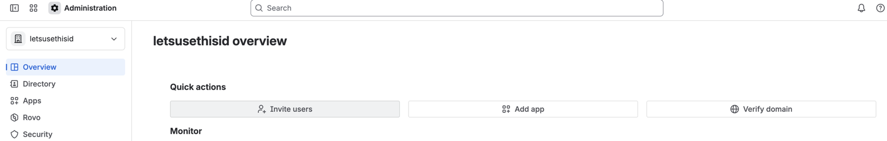{align="center"}

1. Geben Sie die E-Mail-Adresse des Kontos ein.
1. Suchen Sie in der **Apps**-Liste nach **Jira** und setzen Sie **Role** auf **User**. Verwenden Sie nicht **Guest**, da dadurch nur ein zugewiesener Bereich zugänglich ist.

   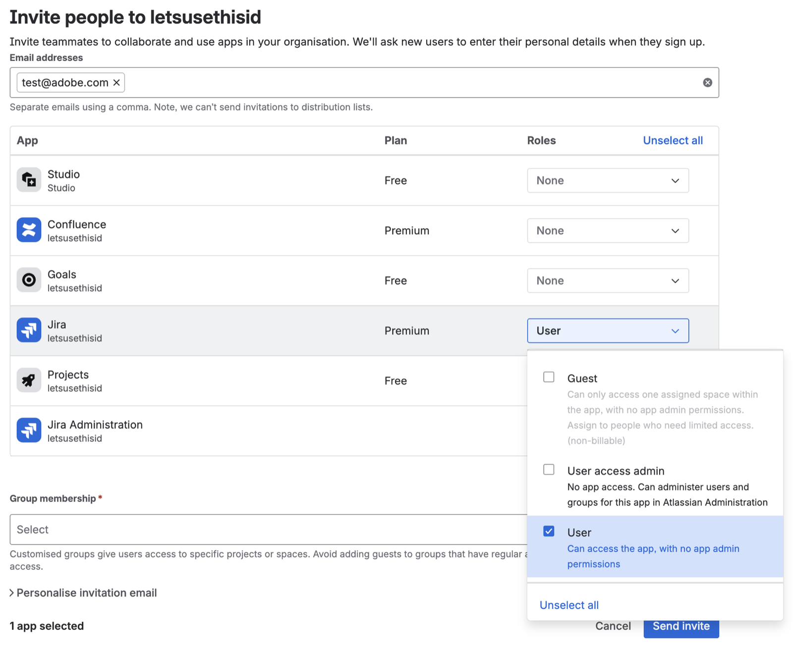{align="center"}

1. Legen Sie **Gruppenmitgliedschaft** auf `jira-users-<site>` fest, die standardmäßige Jira-Gruppe. Dadurch wird Produktzugriff und die integrierte Projektrolle **Mitglied** gewährt.

   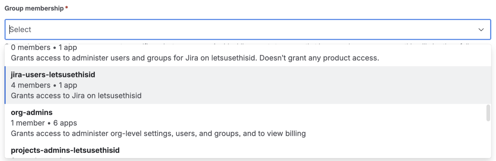{align="center"}

1. Bestätigen Sie, dass die Rolle **Benutzer** und die Gruppe `jira-users-<site>` ist, und wählen Sie dann **Einladung senden** aus.

Das eingeladene Konto nimmt die Einladung an und meldet sich mit einem Atlassian-Konto an bzw. erstellt es.

>[!IMPORTANT]
>
>Es muss möglich sein, Probleme in jedem Jira-Projekt zu erstellen, in dem Sites Optimizer Tickets erstellen soll. Wenn Ihre Projekte benutzerdefinierte Berechtigungsschemata verwenden, bitten Sie Ihren Jira-Administrator, dem Konto die Berechtigung **Probleme erstellen** zu erteilen.

### Dem Konto Zugriff auf Sites Optimizer erteilen {#grant-aso-access}

Das Konto, das die Jira-Verbindung autorisiert, muss sich für Ihr Unternehmen bei Sites Optimizer anmelden können. Wie Sie diesen Zugriff gewähren, hängt von Ihrem Sites Optimizer-Plan ab.

>[!BEGINTABS]

>[!TAB Bezahlte Kunden]

Fügen Sie das Konto einem AEM Sites Optimizer-Produktprofil in der Adobe Admin Console hinzu:

1. Navigieren Sie zu [adminconsole.adobe.com](https://adminconsole.adobe.com) und wählen Sie **Produkte** > **Adobe Experience Manager Sites Optimizer** aus.
1. Wählen Sie das Produktprofil aus, das das Konto benötigt. Die Jira-Integration ist in allen Sites Optimizer-Produktprofilen verfügbar.

   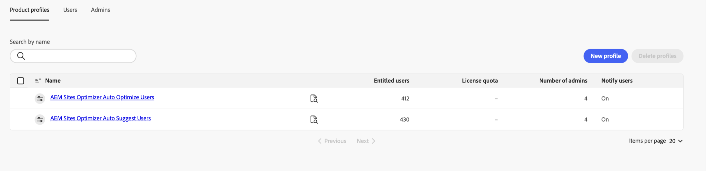{align="center"}

1. Wählen Sie die Registerkarte **Benutzer**, wählen Sie **Benutzer hinzufügen**, geben Sie die E-Mail-Adresse des Kontos ein und klicken Sie auf **Speichern**.

Weitere Informationen zu Produktprofilen und Rollen finden Sie unter [Verwalten von Benutzerberechtigungen](/help/documentation/manage-permissions.md).

>[!TAB Testkunden]

Die Sites Optimizer-Testversion umfasst keine Sites Optimizer-Produktprofile in der Admin Console. Stattdessen benötigt das Konto Zugriff auf Adobe Experience Manager in Ihrer Adobe-Organisation:

1. Stellen Sie sicher, dass das Konto ein Benutzer in Ihrer Adobe-Organisation ist.
1. Stellen Sie sicher, dass dem Konto ein Produktprofil für mindestens eines dieser Produkte zugewiesen ist:

   * **Adobe Experience Manager as a Cloud Service**
   * **Adobe Experience Manager Managed Services**
   * **Adobe Experience Manager Edge Delivery Services**

   Wenn das Konto keines dieser Produktprofile hat, bitten Sie den Systemadministrator Ihrer Adobe-Organisation, eines in der [Adobe Admin Console](https://adminconsole.adobe.com) zuzuweisen.

1. Melden Sie sich mit dem -Konto bei Sites Optimizer an und wählen Sie Ihr Unternehmen aus. Siehe [Sites Optimizer-Testversion](/help/documentation/trial.md).

>[!ENDTABS]

>[!IMPORTANT]
>
>Fügen Sie das Konto Ihrer Adobe-Organisation hinzu **bevor** die Jira-Verbindung autorisiert. Andernfalls schlägt die Verbindung mit „Sie sind kein Mitglied dieser Organisation“ fehl.

## Verbinden von Jira und Festlegen von Ticket-Standardwerten {#configure-jira}

<!-- VIDEO TODO: connect and configure Jira (about 60 seconds). -->

### Mit Jira verbinden {#connect-to-jira}

<!-- CONFIRM: only an administrator can connect Jira and set ticket creation defaults? Carried over from PR #162; not confirmed. -->

1. Melden Sie sich mit dem von Ihnen vorbereiteten Konto bei Sites Optimizer an.
1. Wählen Sie **Einstellungen** aus und navigieren Sie zum Abschnitt **Mit Jira Cloud verbinden**. Eine neue Verbindung zeigt den Status **Nicht verbunden** an.

   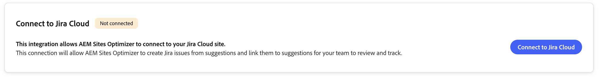{align="center"}

1. Wählen **Mit Jira-Cloud verbinden** aus.
1. Autorisieren Sie auf der Seite Atlassian die Verbindung und wählen Sie Ihre Jira-Site aus, wenn Sie dazu aufgefordert werden.

   <!-- SCREENSHOT TODO: {align="center"} -->

Wenn Sie zu Sites Optimizer zurückkehren, ändert sich der Status in **Verbunden** und der Abschnitt zeigt **Verbundene Site** mit Ihrer Jira-Site-URL an.

>[!NOTE]
>
>Die Verbindung gilt für Ihre gesamte Organisation. Es wird von allen Sites und Benutzern gemeinsam genutzt und alle Änderungen in **Einstellungen** gelten für alle. Sie können jeweils nur eine Jira-Site verbinden. Um eine andere Jira-Site zu verwenden, trennen Sie zuerst die aktuelle.

### Standardeinstellungen für die Ticketerstellung festlegen {#ticket-defaults}

Nachdem Sie die Verbindung hergestellt haben, legen Sie die Standardeinstellungen fest, die Sites Optimizer auf jedes Ticket anwendet.

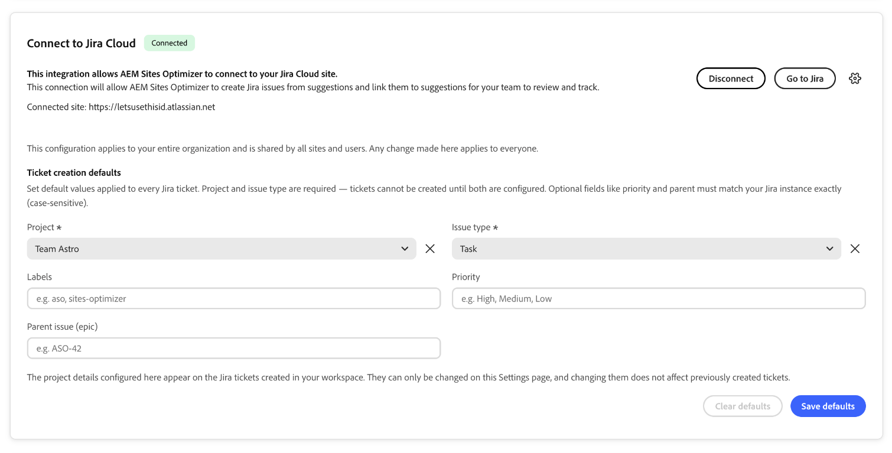{align="center"}

| Feld | Erforderlich | Beschreibung |
|---|---|---|
| **Projekt** | Ja | Das Jira-Projekt, in dem Tickets erstellt werden. |
| **Anfragetyp** | Ja | Der Jira-Problemtyp für neue Tickets, z. B **„Aufgabe**. Verfügbar, nachdem Sie ein Projekt ausgewählt haben. |
| **Kennzeichnungen** | Nein | Zu jedem Ticket hinzugefügte Kennzeichnungen, z. B. `aso` oder `sites-optimizer`. |
| **Priorität** | Nein | Die standardmäßige Ticketpriorität, z. B **„Hoch**, **Medium** oder **Niedrig**. |
| **Übergeordnetes Problem (episch)** | Nein | Der Schlüssel eines Epos, mit dem Tickets verknüpft werden sollen, z. B. `ASO-42`. |

Wählen Sie **Standardeinstellungen speichern**. Eine Meldung „Ticket Defaults saved“ bestätigt die Änderung.

>[!IMPORTANT]
>
>Tickets können erst erstellt werden, wenn Sie sowohl **Projekt** als auch **Problemtyp** festgelegt haben. **Priorität** und **Übergeordnetes Problem (episch)** müssen genau mit Ihren Jira-Werten übereinstimmen, einschließlich der Groß-/Kleinschreibung.

Änderungen, die Sie an den Standardeinstellungen vornehmen, gelten nur für neue Tickets. Bereits erstellte Tickets werden nicht geändert. Wenn Sie ein Ticket erstellen, können Sie jeden dieser Werte für dieses Ticket ändern, ohne die gespeicherten Standardwerte zu beeinflussen.

### Verbindung überprüfen {#verify-connection}

Vergewissern Sie sich, dass die Einrichtung funktioniert:

* Die **Projekt**-Liste in **Standardeinstellungen für die Ticketerstellung** zeigt Ihr Jira-Projekt.
* Beim Erstellen eines Tickets aus einer Opportunity werden ein Jira-Ticketschlüssel und ein Link zurückgegeben.
* Wenn für die Probleme ein Code-Patch vorgeschlagen wird, enthält das Ticket diesen als Anlage.

### Verwalten der Verbindung {#manage-connection}

Verwenden Sie die Schaltflächen im Abschnitt **Verbindung zu Jira Cloud herstellen**, um die Verbindung zu verwalten:

* **Wechseln zu Jira**: Öffnet Ihre verbundene Jira-Site.
* **Verbindung zu Jira wiederherstellen**: Wird angezeigt, wenn der Status &quot;**Autorisierung erforderlich“**. Wählen Sie diese Option aus und autorisieren Sie die Verbindung erneut mit derselben Jira-Site.
* **Trennen**: Entfernt die Integration, nachdem Sie bestätigt haben **Jira trennen?**. Sie können keine Tickets mehr aus Opportunities erstellen, bis Sie erneut eine Verbindung herstellen.
* **Standardwerte löschen**: Entfernt alle gespeicherten Standardwerte. Die Ticket-Erstellung ist erst verfügbar, wenn Sie **Projekt** und **Anfragetyp** erneut festlegen.

### Fehlerbehebung bei Verbindungsfehlern {#connection-errors}

| Meldung | Vorgehensweise |
|---|---|
| Sie sind kein Mitglied dieser Organisation. Bitten Sie Ihren Administrator, Sie hinzuzufügen, bevor Sie Jira verbinden. | Fügen Sie das Konto Ihrer Adobe-Organisation und Ihrem Produktprofil hinzu. Siehe [Dem Konto Zugriff auf Sites Optimizer gewähren](#grant-aso-access). |
| Sie haben eine andere Jira-Site ausgewählt. Zuerst die aktuelle Verbindung trennen, dann die neue Seite verbinden. | Wählen Sie **Trennen** und verbinden Sie dann die gewünschte Jira-Site. |
| Für Ihre Organisation besteht bereits eine Verbindung zu dieser Jira-Site. | Die Seite ist bereits verbunden. Öffnen Sie **Einstellungen**, um die Verbindung zu überprüfen. |
| Jira-Autorisierung wurde verweigert. Bitte erneut versuchen und bei Aufforderung Zugriff gewähren. | Wählen Sie **Mit Jira Cloud verbinden** erneut aus und erlauben Sie den Zugriff auf die Atlassian-Seite. |
| Die Autorisierungssitzung ist abgelaufen. Bitte erneut versuchen, eine Verbindung herzustellen. | Wählen Sie **Mit Jira Cloud verbinden** erneut aus und beenden Sie die Atlassian-Autorisierung innerhalb von 10 Minuten. |

## Erstellen von Jira-Tickets aus Opportunities {#create-tickets}

Sie können Tickets aus den folgenden sieben Möglichkeiten erstellen:

* [Fehlender Alternativtext](/help/documentation/opportunities/missing-alt-text.md)
* [Fehlerhafte Backlinks](/help/documentation/opportunities/broken-backlinks.md)
* [Fehlerhafte interne Links](/help/documentation/opportunities/broken-internal-links.md)
* [Core Web Vitals](/help/documentation/opportunities/core-web-vitals.md)
* [Barrierefreiheitsprobleme](/help/documentation/opportunities/accessibility-issues.md) (Beheben von ARIA-Bezeichnungen)
* Farbkontrast
* [Probleme mit der Barrierefreiheit von Formularen](/help/documentation/opportunities/forms-accessibility-issues.md)

<!-- CONFIRM: the docs repo has no page for the Color contrast opportunity (accessibility-issues.md does not mention it). Link it once a page exists. -->

Die Beispiele in diesem Artikel verwenden fehlenden Alternativtext, fehlerhafte Backlinks und zentrale Web-Vitalwerte. Die Schritte sind für die anderen Opportunitys gleich.

<!-- VIDEO TODO: create a ticket from an opportunity (about 60-90 seconds). -->

### Erstellen eines Tickets {#create-a-ticket}

Die Schritte sind für jede unterstützte Opportunity gleich.

1. Öffnen Sie die Opportunity und wählen Sie ein oder mehrere Probleme aus.
1. Wählen Sie **Ticket erstellen** aus.

   Wenn Jira nicht verbunden ist, zeigt die Seite stattdessen **Jira konfigurieren** an. Wählen Sie diese Option aus, um den Jira-Abschnitt in **Einstellungen** zu öffnen und dann [Jira verbinden und Ticket-Standardeinstellungen festlegen](#configure-jira) abzuschließen.

1. Überprüfen Sie **Dialogfeld „Jira-** erstellen“ die Ticketdetails. Das Dialogfeld ist aus Ihren Standardeinstellungen und den ausgewählten Problemen vorausgefüllt.
1. Wählen Sie **Erstellen** aus.

Das Dialogfeld enthält die folgenden Felder:

| Feld | Beschreibung |
|---|---|
| **Ticketname** | Die Ticket-Zusammenfassung. Erforderlich. |
| **Tags** | Dem Jira-Ticket wurden Beschriftungen hinzugefügt. |
| **Projekt** | Das Jira-Projekt. Erforderlich. |
| **Priorität** | Die Ticketpriorität. |
| **Anfragetyp** | Der Jira-Problemtyp. Erforderlich. Wählen Sie zuerst ein Projekt aus. |
| **Episch (übergeordnet)** | Der Schlüssel eines übergeordneten Epos, z. B. `ASO-42`. |
| **Anfragename** und **Anfragebeschreibung** | Ein Paar für jedes ausgewählte Problem. Bearbeiten Sie sie, um die Aussagen des Tickets zu den einzelnen Problemen anzupassen. |

Sites Optimizer erstellt das Ticket und zeigt „Jira-Ticket erstellt“ an. Der Jira-Schlüssel des Tickets wird als Link in der Spalte **Ticket-Link** der Problemliste angezeigt. Wählen Sie den Link aus, um das Ticket in Jira zu öffnen. Probleme ohne Ticket zeigen einen Bindestrich (-) an.

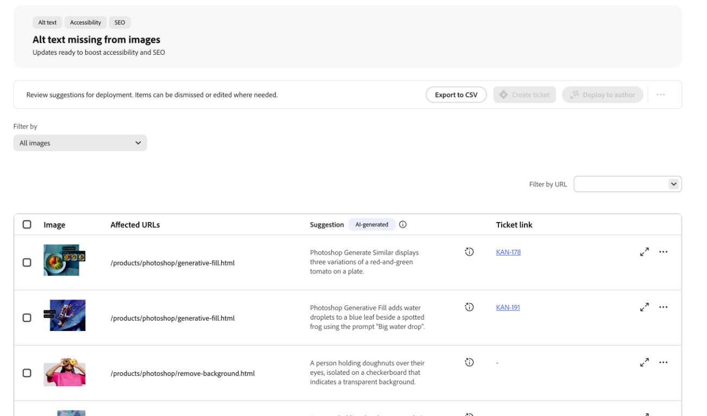{align="center"}

>[!NOTE]
>
>Wenn Sie mehr als ein Problem auswählen, erstellt Sites Optimizer **ein gruppiertes Ticket** das jedes ausgewählte Problem auflistet. Es wird nicht für jedes Problem ein separates Ticket erstellt. Jedes Problem kann nur zu einem Ticket gehören. **Ticket erstellen** ist deaktiviert, wenn keine Probleme ausgewählt sind oder wenn ein ausgewähltes Problem bereits ein Ticket hat. Löschen Sie die Probleme, bei denen bereits ein Ticket-Link angezeigt wird, und wählen Sie dann **Ticket erstellen** aus.

<!-- CONFIRM: the Accessibility dialog uses a single Title and Description editor (with Preview) instead of per-issue Issue Name/Issue Description cards. Decide whether to call this out. Also confirm the accessibility code-fix attachment wording: it is attached only when the code-patch auto-fix is enabled. -->

In den Feldern **Problembeschreibung** und **Beschreibung** können Sie Markdown verwenden, z. B. `**bold**`, `*italic*`, `- bullets` und nummerierte Listen. Wechseln Sie **„Vorschau**, um die Formatierung zu überprüfen.

In den folgenden Beispielen werden Opportunitys genutzt, die jeder Sites Optimizer-Kunde nutzen kann, sodass Sie in jedem Plan dasselbe Erlebnis sehen. Im ersten Beispiel wird ein Ticket für ein Problem erstellt, im zweiten für mehrere Probleme gleichzeitig. Im dritten Beispiel wird ein Ticket mit einem Code-Patch-Anhang angezeigt.

### Beispiel: Erstellen eines Tickets für ein Problem {#example-single-issue}

Verwenden Sie ein Ticket für ein einzelnes Problem, wenn eine Fehlerbehebung einen eigenen Besitzer oder ein Fälligkeitsdatum erfordert. In diesem Beispiel wird **Fehlender ALT-Text** verwendet.

1. Öffnen Sie **Fehlender ALT-Text** und wählen Sie ein Bild aus.

   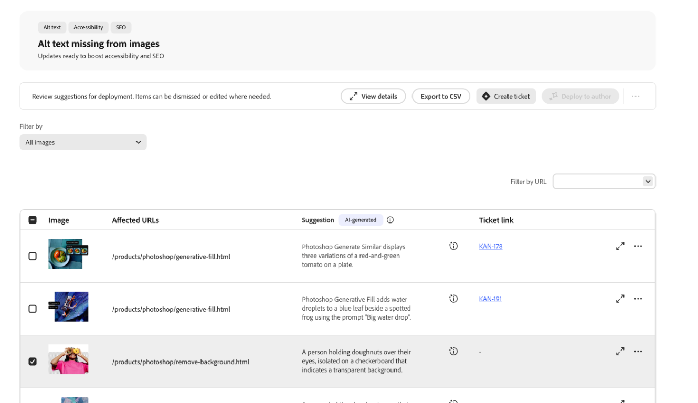{align="center"}

1. Wählen Sie **Ticket erstellen** aus.
1. Behalten Sie im **Jira-Ticket erstellen** den vorausgefüllten **Ticketnamen**, z. B. `[ASO] Missing alt text – found on https://www.adobe.com/de/products/photoshop/generative-fill.html`, bei oder bearbeiten Sie ihn.
1. Überprüfen Sie **Problemname** und **Problembeschreibung**. Die Beschreibung listet die **Seiten-**), die **Bild-** URL) und den **Vorgeschlagenen Alternativtext**.

   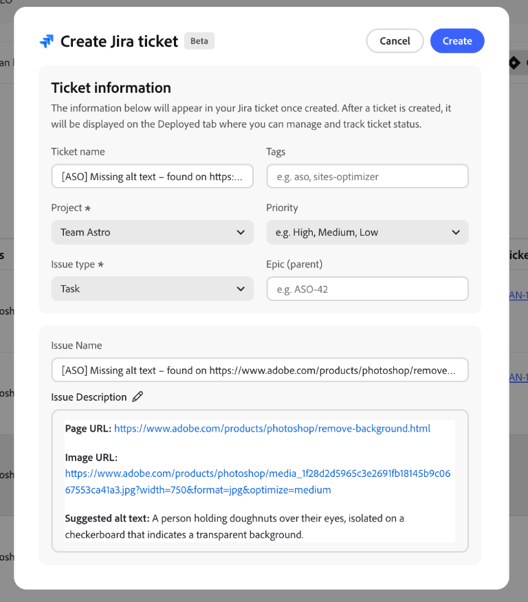{align="center"}

1. Wählen Sie **Erstellen** aus.

Das Jira-Ticket listet die betroffene Seite auf, gefolgt vom Problem:

```markdown
**Affected pages:**
- https://www.adobe.com/de/products/photoshop/generative-fill.html

---

**[ASO] Missing alt text – found on https://www.adobe.com/de/products/photoshop/generative-fill.html**

**Page URL:** https://www.adobe.com/de/products/photoshop/generative-fill.html

**Image URL:** https://www.adobe.com/de/cc-shared/fragments/products/photoshop/generative-fill/personalization/media_1986ceaab1420f3df0c4ff92b962e01bd402c0d53.jpg?width=750&format=jpg&optimize=medium

**Suggested alt text:** Photoshop Generate Similar displays three variations of a red-and-green tomato on a plate.
```

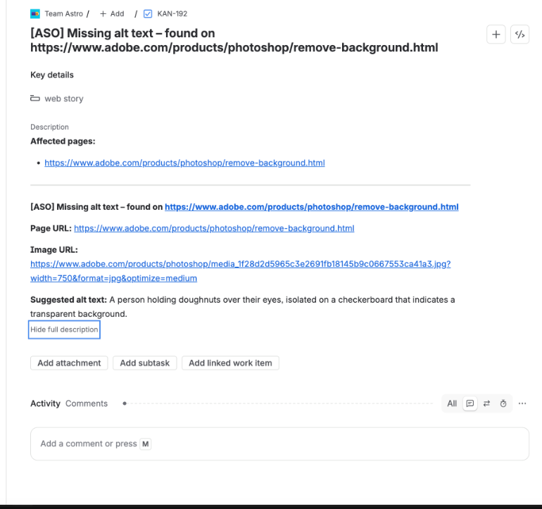{align="center"}

### Beispiel: Erstellen eines Tickets für mehrere Probleme {#example-multiple-issues}

Verwenden Sie ein gruppiertes Ticket, wenn ein Team mehrere Probleme gleichzeitig behebt. In diesem Beispiel wird **Broken backlinks** verwendet.

1. Öffnen Sie **Beschädigte Backlinks** und wählen Sie mehrere Backlinks aus.
1. Wählen Sie **Ticket erstellen** aus.
1. Überprüfen Sie **Dialogfeld „Jira** Ticket erstellen“ den **Ticketnamen**. Bei mehreren ausgewählten Problemen wird die Anzahl der betroffenen Seiten angezeigt, z. B. `[ASO] Broken backlink found – 2 pages`. Das Dialogfeld zeigt ein **Problemname** und **Problembeschreibung** für jeden ausgewählten Backlink an.

   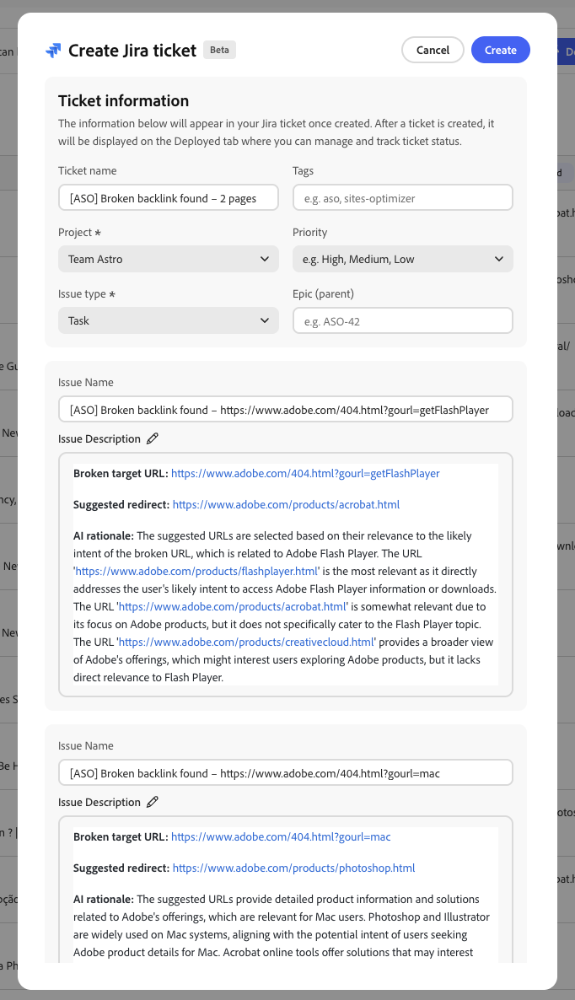{align="center"}

1. Überprüfen Sie für jeden Backlink die **fehlerhafte Ziel-URL** und die **vorgeschlagene Umleitung**. Sofern verfügbar, enthält die Beschreibung auch die **KI-Begründung**. Wenn Sie die vorgeschlagene Umleitung in der Opportunity bearbeitet haben, verwendet das Ticket Ihre bearbeitete URL.
1. Wählen Sie **Erstellen** aus.

Sites Optimizer erstellt ein Ticket. Es werden die verweisenden Seiten aufgelistet, gefolgt von einem Abschnitt für jeden Backlink. Horizontale Linien trennen die Abschnitte:

```markdown
**Referring pages:**

- https://archive.nytimes.com/www.nytimes.com/library/cyber/qa/101797qa.html
- https://www.theguardian.com/education/gcses2003/0,13395,976930,00.html

---

**[ASO] Broken backlink found – https://www.adobe.com/support/flash/how/subjects/jpdemo/**

**Broken target URL:** https://www.adobe.com/support/flash/how/subjects/jpdemo/

**Suggested redirect:** https://www.adobe.com/de/support/flash/

---

**[ASO] Broken backlink found – https://www.adobe.com/shockwave/download/download.cgi?P1_Prod_Version=ShockwaveFlash&P5_Language=English**

**Broken target URL:** https://www.adobe.com/shockwave/download/download.cgi?P1_Prod_Version=ShockwaveFlash&P5_Language=English

**Suggested redirect:** https://www.adobe.com/de/shockwave/download/
```

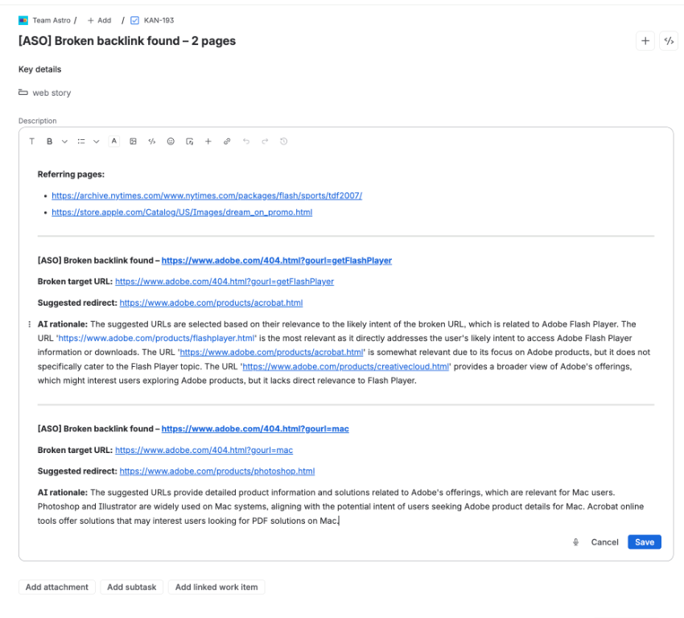{align="center"}

Beide Backlinks zeigen nun in der Spalte **Ticket-Link** denselben Jira-Schlüssel an, da sie zu einem gruppierten Ticket gehören.

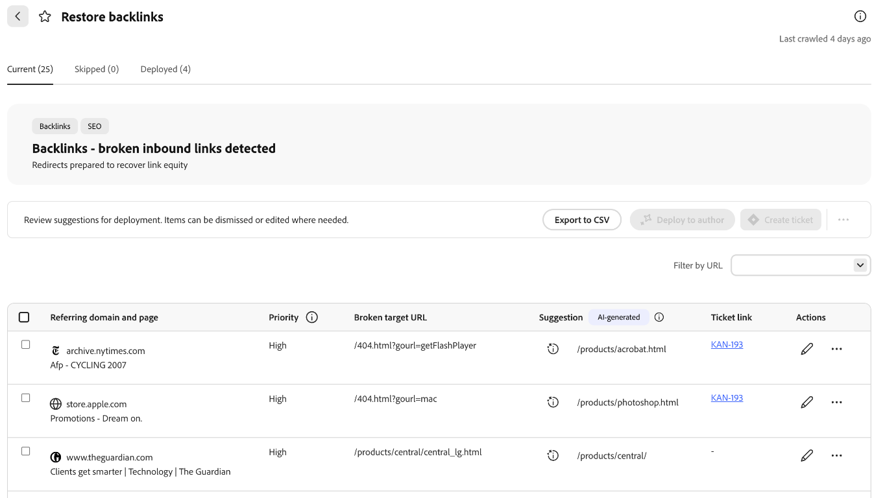{align="center"}

### Beispiel: ein Ticket mit einem Code-Patch-Anhang {#example-core-web-vitals}

Wenn Sites Optimizer einen Code-Patch für die ausgewählten Probleme vorschlägt, wird der Patch an das Jira-Ticket angehängt. Wenn mehr als ein Patch gilt, werden sie in einer Datei zusammengefasst, sodass die Entwickler die Änderungen überprüfen und anwenden können. Zentrale Web-Vitalfunktionen ist ein gängiges Beispiel.

1. Öffnen Sie **Core Web Vitals** und wählen Sie die Seiten aus, die Sie beheben möchten.
1. Wählen Sie **Ticket erstellen** aus.
1. Überprüfen Sie im Dialogfeld den **Ticketnamen** wie `[ASO] Core Web Vitals issue – 2 affected pages`, und die Details für jede Seite:

   * **Seite**
   * **Desktop-Probleme**: Die fehlschlagenden Metriken auf dem Desktop mit ihren Werten.
   * **Probleme mit Mobilgeräten**: Die fehlschlagenden Metriken auf Mobilgeräten mit ihren Werten.
   * **Recommendations**: Die vorgeschlagenen Fehlerbehebungen für die Seite.

   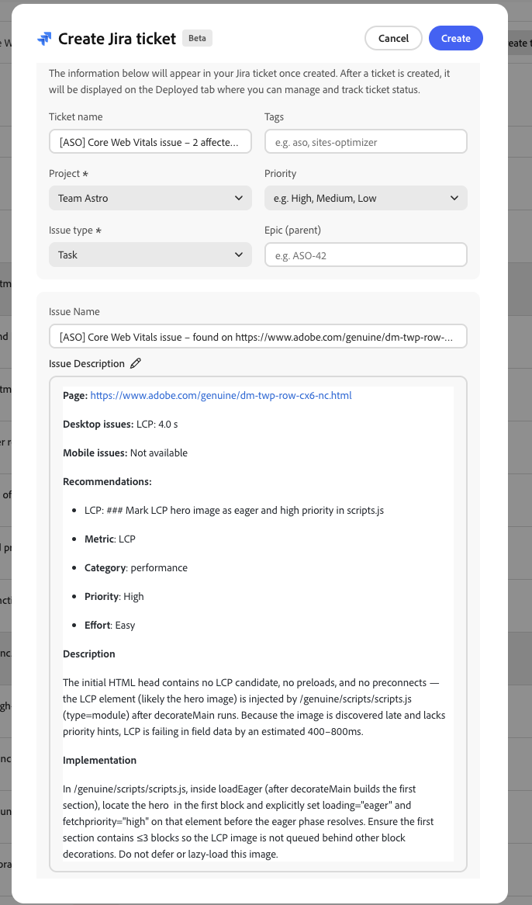{align="center"}

1. Wählen Sie **Erstellen** aus.

Wenn für die ausgewählten Seiten ein Code-Patch vorgeschlagen wird, wird dieser als einzelne `.diff` an das Ticket angehängt. Ein Ticket enthält höchstens einen Anhang von bis zu 3 MB. Wenn kein Patch vorgeschlagen wird, erstellt Sites Optimizer weiterhin das Ticket mit den Details und Empfehlungen, jedoch ohne Anlage.

>[!NOTE]
>
>Wenn der kombinierte Code-Patch für Ihre Auswahl größer als 3 MB ist, kann das Ticket nicht erstellt werden. Wählen Sie weniger Seiten aus und erstellen Sie das Ticket erneut.

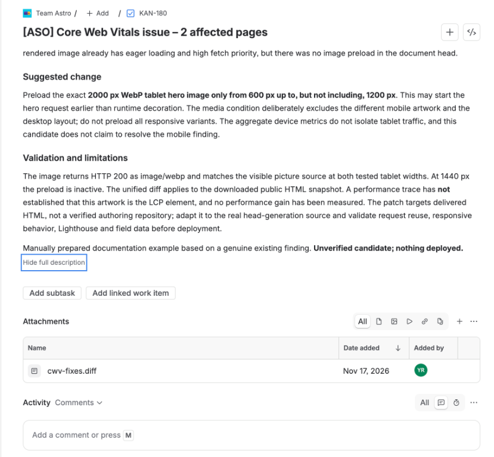{align="center"}

Laden Sie die `.diff`-Datei aus dem Jira-Ticket herunter und wenden Sie sie auf Ihr Code-Repository an, z. B. mit `git apply`. Die Datei enthält den Patch für jede ausgewählte Seite:

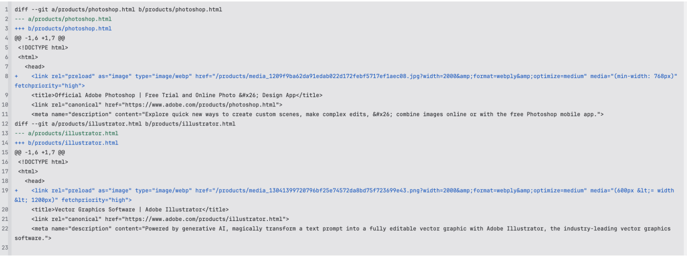{align="center"}

Überprüfen Sie die Änderungen, bevor Sie sie zusammenführen. Weitere Anleitungen finden Sie unter [Vorbereiten von Code-Patches](/help/documentation/opportunities/preparing-code-patches.md).

## Was jedes Ticket enthält {#ticket-contents}

| Möglichkeit | Ticketdetails |
|---|---|
| Fehlender Alternativtext | Betroffene Seiten und für jedes Bild die Seiten-URL, die Bild-URL und den vorgeschlagenen Alternativtext. |
| Fehlerhafte Backlinks | Verweisende Seiten und für jeden Backlink die fehlerhafte Ziel-URL und die vorgeschlagene Umleitung. Sofern verfügbar, die KI-Begründung. |
| Fehlerhafte interne Links | Verweisende Seiten und für jeden Link die fehlerhafte Ziel-URL und die vorgeschlagene Umleitung. Sofern verfügbar, die KI-Begründung. |
| Core Web Vitals | Betroffene Seiten und für jede Seite Desktop-Probleme, Probleme mit Mobilgeräten und Empfehlungen. Dem Ticket ist ein vorgeschlagener Code-Patch beigefügt. |
| Barrierefreiheitsprobleme (Beheben von ARIA-Beschriftungen), Farbkontrast und Probleme mit der Barrierefreiheit von Forms | Betroffene URLs, Problembeschreibungen, der Speicherort der fehlerhaften HTML und vorgeschlagene Fehlerbehebungen. Wenn eine Code-Fehlerbehebung verfügbar ist, wird sie an das Ticket angehängt. |

## Fehlerbehebung bei der Ticketerstellung {#ticket-errors}

Wenn Sites Optimizer „Jira-Ticket konnte nicht erstellt werden“ anzeigt, überprüfen Sie Folgendes:

* **Projekt- und Anfragetyp**: Das ausgewählte Projekt und der ausgewählte Anfragetyp sind weiterhin in Jira vorhanden, und das verbundene Konto kann Probleme in diesem Projekt erstellen.
* **Erforderliche Felder**: Für das Jira-Projekt sind keine zusätzlichen Felder erforderlich, die von Sites Optimizer nicht ausgefüllt werden, z. B. ein benutzerdefiniertes Pflichtfeld. Wählen Sie ein Projekt oder einen Problemtyp ohne zusätzliche erforderliche Felder aus oder bitten Sie Ihren Jira-Administrator, diese Felder optional zu machen.
* **Priorität und übergeordnet**: **Priorität** und **Epic (übergeordnet)** entsprechen den Werten, die auf Ihrer Jira-Site vorhanden sind, genau, einschließlich Groß-/Kleinschreibung.
* **Anlagengröße**: Für Tickets mit Code-Patch beträgt der kombinierte Patch 3 MB oder weniger. Wählen Sie weniger Probleme aus und versuchen Sie es erneut.
* **Verbindungsstatus**: In **Einstellungen** lautet der **Mit Jira Cloud verbinden** Status **Verbunden**. Wenn die Meldung **Erneute Autorisierung erforderlich** angezeigt wird, wählen Sie **Verbindung zu Jira wiederherstellen** aus.

## Häufig gestellte Fragen {#faq}

+++Kann ich für jedes Problem ein Ticket anstelle eines gruppierten Tickets erstellen?

Nein. Wenn Sie mehrere Probleme auswählen, wird immer ein gruppiertes Ticket erstellt.

+++

+++Kann ich den Projekt- oder Problemtyp für ein Ticket ändern?

Ja. Ändern Sie **Projekt** oder **Problemtyp** im Dialogfeld **Jira-Ticket erstellen**. Die Änderung gilt nur für dieses Ticket. Um die Standardeinstellungen für alle neuen Tickets zu ändern, aktualisieren Sie **Standardeinstellungen für die Ticketerstellung** unter **Einstellungen**.

+++

+++Zeigt Sites Optimizer den Status eines Jira-Tickets an?

Sites Optimizer zeigt in der Spalte „Ticketlink **der Problemliste einen Link** das Jira-Ticket an. Verwalten Sie das Ticket selbst, einschließlich seines Status, des Verantwortlichen und der Kommentare, in Jira.

+++

+++Kann ich Jira Data Center oder Jira Server verwenden?

Nein. Die Integration unterstützt nur Jira Cloud.

+++

## Siehe auch {#also-see}

* [Sites Optimizer-Einstellungen](/help/documentation/settings.md)
* [Opportunities - Übersicht](/help/documentation/opportunities/overview.md)
* [Vorbereiten von Code-Patches](/help/documentation/opportunities/preparing-code-patches.md)
