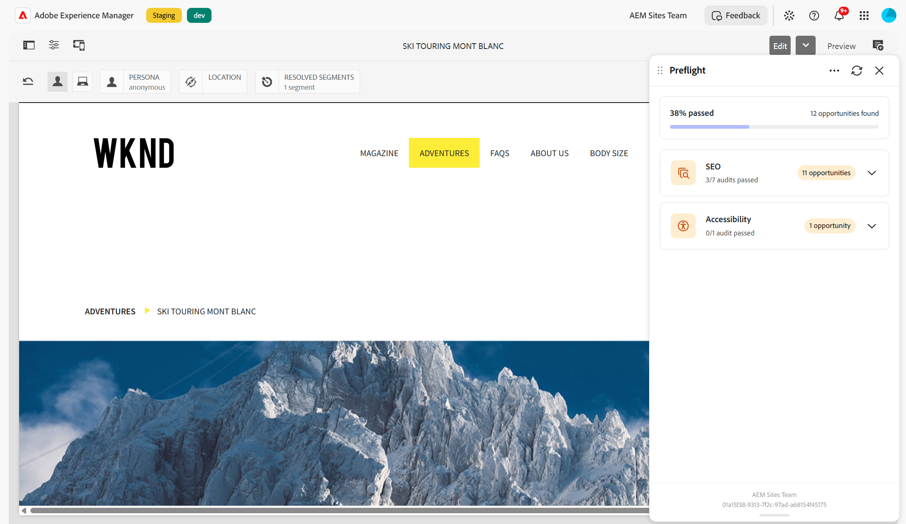

# Audit-Ergebnisse in Preflight

Nach Abschluss der Audits zeigt Preflight die Ergebnisse im Ergebnis-Dashboard an. Das Dashboard zeigt einen Gesamtergebniszähler und die gefundenen Chancen an, gruppiert nach Auditkategorie. Innerhalb jeder Kategorie werden bei individuellen Audits spezifische Elemente identifiziert, die überprüft oder korrigiert werden müssen.

## Symbolleiste

Die Symbolleiste am oberen Rand des Ergebnis-Dashboards enthält Aktionen für die aktuelle Ausführung:

* **Neu analysieren** - Startet einen brandneuen Audit-Durchgang auf der aktuellen Seite. Bei der Neuanalyse werden die angezeigten Ergebnisse immer verworfen und alle Prüfungen werden erneut ausgeführt. Verwenden Sie sie daher, wann immer Sie neue Ergebnisse wünschen - beispielsweise nach der Bearbeitung der Seite. Wählen **in** Symbolleiste „Neu analysieren“ aus.
* **Exportieren** - Laden Sie die aktuelle Ausführung als **CSV** (Tabellenfreundlich) oder **PDF** (formatiertes Dokument) herunter. Wählen Sie je nach Umgebung **Exportieren** in der Symbolleiste oder unter **Mehr Aktionen** aus (**…**) Menü.
* **Einstellungen** - Verwenden Sie **Site-Navigations-Links anzeigen** um Site-Navigations-Links einzuschließen (derzeit nur interne Links). Wählen Sie das Zahnradsymbol aus oder öffnen Sie **Mehr Aktionen** (**…**) und wählen Sie **Einstellungen** aus. Einstellungen sind vor oder nach der Ausführung verfügbar, nicht jedoch während der Ausführung von Audits oder im universellen Editor. Siehe [Einschließen von Site-Navigations-Links](./opportunities/seo/internal-links.md#include-site-navigation-links).

Wenn Sie eine Einstellung nach einem Durchlauf ändern, geben ein Punkt auf **Neu analysieren** und die Beschriftung **Neu analysieren, um neue Einstellungen anzuwenden** an, dass die angezeigten Ergebnisse eine andere Einstellung verwendet haben. Wählen Sie **Neu analysieren** aus, um die gespeicherte Einstellung auf eine neue Ausführung anzuwenden.

Beim Exportieren können Sie auch auswählen, was einbezogen werden soll:

* **Metadatentabelle einschließen** - Fügen Sie eine Tabelle mit Ausführungsdetails hinzu, z. B. den Host, den Inhaltspfad und Erzeugungsdetails.
* **Bestehende Audits einschließen** - Schließt die Audits ein, die ohne Opportunities bestanden wurden, nicht nur die gefundenen Opportunities.

>[!NOTE]
>
>PDF-Exporte werden unabhängig von der Sprache der Benutzeroberfläche immer in englischer Sprache generiert. CSV-Exporte folgen der Sprache Ihrer Benutzeroberfläche so genau wie möglich.

## Ergebniszähler

Oben im Dashboard zeigt die Ergebnisanzeige die gesamten Auditergebnisse an. Er zeigt den Prozentsatz der Prüfungen, die ohne Opportunities abgeschlossen wurden, mit der Bezeichnung **% bestanden**, zusammen mit der Gesamtzahl der in allen Prüfungen gefundenen Opportunitys. Beispielsweise **85 % bestanden** bedeutet, dass 85 % der abgeschlossenen Prüfungen keine Chancen fanden. Dieser Prozentsatz beschreibt die Audit-Ergebnisse, nicht den Fortschritt während des Durchgangs.

{align="center"}

Wenn Sie eine Ausführung anzeigen, die von einer vorherigen Sitzung neu geladen wurde, wird in der Kopfzeile angezeigt, wie lange sie durchgeführt wurde, z. B *„gestern*. Weitere Informationen finden Sie unter [Fortsetzen einer vorherigen Sitzung](./audits.md#continue-a-previous-session).

Während die Audits noch ausgeführt werden, zeigt das Dashboard **Analysierende Seite** mit einem kurzen Status darunter an. Zunächst wird eine Fortschrittsleiste angezeigt, bevor benannte Auditkategorien eintreffen. Danach wird ein Verarbeitungsanzeiger nur noch neben jedem Audit angezeigt, das noch ausgeführt wird, nicht in seiner Kategorie. Wenn alle Prüfungen abgeschlossen sind, zeigt das Messgerät den endgültigen Prozentsatz und die Anzahl der Vertriebschancen an.

## Audit-Kategorien

Preflight gruppiert verwandte Audits in Kategorien wie **SEO** und **Accessibility**. Jede Kategorie wird als Karte angezeigt, die die Anzahl der gefundenen Opportunitys anzeigt oder angibt, dass alle ihre Audits ohne Opportunitys erfolgreich waren.

Erweitern Sie eine Kategorie, um ihre individuellen Audits anzuzeigen. Bei jedem Audit wird angezeigt, ob Opportunities bestanden oder gefunden wurden, eine kurze Beschreibung und eine Anzahl der gefundenen Opportunitys. Wählen Sie ein Audit aus, bei dem Möglichkeiten zum Öffnen der Detailseite gefunden wurden.

Eine Kategorie kann Ergebnisse anzeigen, während einige ihrer Prüfungen noch laufen. Ihr Status besagt beispielsweise, dass **3/3 Audits bisher bestanden**. Diese Anzahl umfasst nur die Audits, die Ergebnisse zurückgegeben haben. Sie kann sich also ändern, wenn weitere Ergebnisse eingehen. Erweitern Sie die Kategorie, um zu sehen, welche Audits noch ausgeführt werden. Eine Kategorie ohne Opportunities zeigt erst nach Abschluss ihrer ausstehenden Arbeiten ihr Häkchen mit einem Häkchen an.

Eine vollständige Liste der Audit-Kategorien und der Audits in den einzelnen Kategorien finden Sie unter [Preflight-Auditkategorien](./overview.md#preflight-audit-categories).

## Details der Möglichkeiten

Auf der Detailseite werden die Chancen angezeigt, die der ausgewählte Audit gefunden hat. Wenn dasselbe Problem an mehr als einer Stelle auftritt, wird jedes Vorkommen als -Instanz bezeichnet. Verwenden Sie den Navigator (**vorherige Instanz** und **nächste Instanz**), um sie zu durchlaufen. Er zeigt Ihre Position an, z. B. *1 von 5 gefundenen Instanzen*. Um zum Ergebnisse-Dashboard zurückzukehren, klicken Sie auf den Rückwärtspfeil neben dem Audittitel. Das Dashboard wird erneut geöffnet, wobei die Kategorie des Audits erweitert ist.

Bei Prüfungen, die eine bestimmte URL auf der Seite identifizieren, wird der **Element**-Abschnitt oben auf der Karte angezeigt, um das Element einzuführen, und der Rest der Opportunity folgt darunter in seinem eigenen Abschnitt.

Wenn mehrere Opportunities dasselbe Element betreffen - z. B. mehrere Probleme mit demselben Link -, zeigt Preflight sie zusammen auf einer Karte an, jede in einem eigenen Abschnitt mit der zugehörigen Instanznummer, z. B. **Instanz 3**. Der Navigator zeigt dann anstelle einer einzelnen Position einen Bereich an, z. B. *3-5 von 12 gefundenen Instanzen*.

{align="center"}

Jede Opportunity umfasst:

* Details zur Opportunity, z. B. eine Beschreibung des Problems, eine Empfehlung und, bei Barrierefreiheit, die zugehörige WCAG-Regel und Konformitätsstufe.
* Ein **Element**-Abschnitt, der das betroffene Element auf der Seite mit einer Schaltfläche **Hervorheben auf der Seite** identifiziert. Wenn das Element lesbaren Text enthält, wird der Abschnitt **Element: Text** benannt, andernfalls wird er mit **Element: Selektor** bezeichnet und die CSS-Auswahl des Elements angezeigt. Bei **internen Links** und **kanonischen** Opportunities wird in einem Abschnitt **Aktuelle URL** auch die beteiligte URL angezeigt. Wählen Sie **URL kopieren**, um sie in die Zwischenablage zu kopieren, oder **In neuer Registerkarte öffnen**, um sie zu öffnen.
* Ein **Vorschlag** mit einer empfohlenen Fehlerbehebung. Wenn der Vorschlag von KI generiert wird, wird er als von KI generierter Vorschlag markiert und kann eine kurze Begründung zur Erläuterung der vorgeschlagenen Korrektur enthalten.

### Instanzen filtern

Einige Audits bieten einen Filter, der die Detailseite auf die Instanzen fokussiert, die Sie überprüfen möchten. Wenn ein Audit ein Audit bereitstellt, wird ein Filtersymbol neben der Überschrift **Instanzen** angezeigt. Wählen Sie das Symbol und dann eine Option aus. Auf der Seite für jede Prüfung werden die Filteroptionen beschrieben.

Wenn Sie eine andere Option als die Standardoption auswählen, wird ihr Name neben dem Filtersymbol angezeigt, und der Navigator durchläuft nur die entsprechenden Instanzen. Wenn keine übereinstimmen, zeigt Preflight **Keine Instanzen stimmen mit diesem Filter überein.** Wenn auf einer Karte mehr als eine Opportunity für dasselbe Element angezeigt wird, kann der Filter einige davon ausblenden.

Der Filter ändert nicht die Anzahl der Opportunities im Ergebnis-Dashboard oder im exportierten Bericht.

## Auf Seite hervorheben

Nach Abschluss der Audits können Sie eine Opportunity schnell finden und verstehen, indem Sie sie direkt auf der Seite hervorheben.

Preflight markiert das betroffene Element im Kontext und verbindet das Ergebnis im Bedienfeld mit der genauen Position in Ihrem Inhalt. Dies erleichtert die Prüfung und Lösung von Möglichkeiten, ohne die Seite manuell durchsuchen zu müssen.

1. Öffnen Sie das Preflight-Bedienfeld im Kontext der zu prüfenden Seite und wählen Sie **Seite analysieren** aus, um die Prüfungen durchzuführen.
1. Wählen Sie im Ergebnis-Dashboard eine Prüfung und dann eine zu überprüfende Gelegenheit aus.
1. Wählen Sie **Markieren auf Seite** aus. Die Vorschau scrollt automatisch zum relevanten Bereich und markiert das entsprechende Element, sodass Sie die Opportunity im Kontext leicht identifizieren und optimieren können.

Hervorheben ist nicht bei jeder Opportunity möglich. Wenn eine Opportunity beispielsweise nicht mit einem bestimmten Element verknüpft ist, ist das Element ausgeblendet oder befindet es sich nicht mehr auf der Seite. In diesen Fällen ist die Schaltfläche **Markieren auf Seite** abgeblendet. Bewegen Sie den Mauszeiger darüber, um zu sehen, warum.

Im universellen Editor wird die Hervorhebung für Opportunities **Barrierefreiheit** noch nicht unterstützt. Die Schaltfläche **Auf Seite hervorheben** ist abgeblendet, und Sie können den Mauszeiger darüber bewegen, um zu sehen, warum das so ist.

Im universellen Editor kann Preflight nur bearbeitbare Inhalte markieren. Wenn das betroffene Element nicht Teil des bearbeitbaren Inhalts ist, ist die Schaltfläche **Hervorheben auf Seite** abgeblendet. Bewegen Sie den Mauszeiger darüber, um zu sehen, warum. Wenn das Element selbst nicht direkt bearbeitbar ist, aber der nächste bearbeitbare Block ist, markiert Preflight diesen Block stattdessen und fügt einen Hinweis hinzu, der erklärt, warum.

Im AEM Sites-Seiteneditor und in Adobe Managed Services (AMS) ist zum Hervorheben auch **Bearbeitungsmodus** erforderlich. Im **Vorschaumodus** zeigt Preflight **Hervorheben von Problemen nicht verfügbar** Hinweis: Wechseln Sie in den **Bearbeitungsmodus**, um Elemente auf der Seite hervorzuheben.

## Vorgangs-ID

Jeder PreFlight-Durchgang hat eine eindeutige Auftrags-ID, die unten im Bedienfeld angezeigt wird. Dies ist vor allem dann nützlich, wenn ein Administrator die Fehlerbehebung bei einer bestimmten Ausführung durchführt. Bewegen Sie den Mauszeiger über die ID und wählen Sie das Kopiersymbol rechts neben der ID aus. Die ID wird in die Zwischenablage kopiert und eine Bestätigungsmeldung wird angezeigt. Fügen Sie diese ID bei der Meldung eines Problems hinzu.

Wenn Sie Preflight außerhalb des universellen Editors verwenden - z. B. über die Sidekick oder eine Lesezeichenliste -, wird in der Fußzeile des Bedienfelds auch Ihr Organisationsname über der Auftrags-ID angezeigt. Im universellen Editor wird Ihre Organisation stattdessen in der Kopfzeile von AEM angezeigt.
