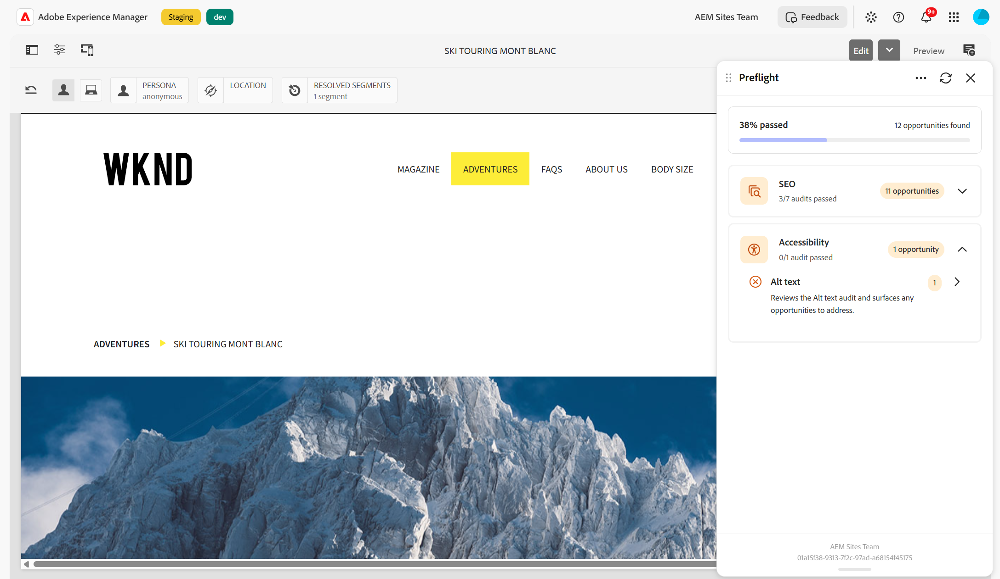

# Zugänglichkeitsprüfungen

{align="center"}

Beim **Barrierefreiheits**-Audit in Preflight wird Ihre Seite anhand der Web Content Accessibility Guidelines (WCAG) bewertet, um sicherzustellen, dass die Seite für alle, auch für Menschen mit Behinderungen, nutzbar ist. Wenn Sie einen Preflight-Audit ausführen, wird die Seite anhand dieser Barrierefreiheitsstandards bewertet und die gefundenen Probleme werden in Chancen gruppiert, die Sie vor der Veröffentlichung überprüfen und beheben können. Weitere Informationen zu den Barrierefreiheitsprüfungen und den Richtlinien, die sie abdecken, finden Sie unter [Probleme mit der Barrierefreiheit](/help/documentation/opportunities/accessibility-issues.md).

Erweitern Sie im Ergebnisse-Dashboard die Kategorie **Barrierefreiheit**, um zu sehen, ob der Audit erfolgreich war und wie viele Gelegenheiten er gefunden hat. Wählen Sie das Audit aus, um seine Detailseite zu öffnen und die Opportunitys zu durcharbeiten. Jede Opportunity beschreibt das Problem der Barrierefreiheit und die zugehörige WCAG-Regel und Konformitätsstufe sowie das betroffene Element auf der Seite. Wenn das Element lesbaren Text hat, wird dieser Text in Preflight angezeigt, sodass Sie das Element leichter erkennen können. Andernfalls wird der CSS-Selektor des Elements angezeigt. Informationen zur Interpretation der Ergebnisse und zur Lösung von Opportunities finden Sie unter [Audit results in Preflight](../audit-results.md).
