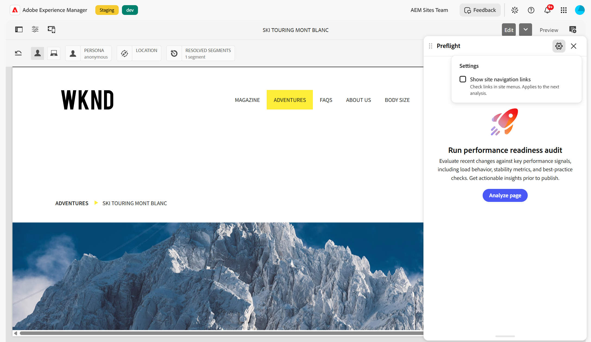

# Prüfung interner Links

Der Audit **Interne Links** überprüft die Links auf Ihrer Seite, die auf Ihre eigene Site verweisen. Die Prüfung prüft jeden internen Link auf der Seite, die Sie bearbeiten, und kennzeichnet die fehlerhaften, unsicheren oder spitzen Links, denen ein Besucher nicht folgen kann.

## Warum das wichtig ist

Ein defekter interner Link ist eine Sackgasse für den Leser und ein vergeudeter crawlen für eine Suchmaschine, der keinen Wert auf die Seite weitergibt, die er erreichen sollte. Interne Links sind auch die einfachste Art, durch Zufall zu brechen: eine Seite wird verschoben oder umbenannt, und jeder Link zu ihr hört leise auf zu funktionieren. Da sich alle Links auf Ihrer eigenen Site befinden, können Sie sie auch selbst reparieren.

## Was bei der Prüfung überprüft wird

Die Prüfung zeigt für jeden internen Link, der eines der folgenden Probleme aufweist, eine Opportunity auf:

* **Beschädigter Link:** Der Link gibt einen Fehler zurück, z. B. `Status 404` oder `Status 500`. Ein Link, der nach einer Umleitung zum Fehler führt, wird auf die gleiche Weise gemeldet.
* **Nicht sicherer Link:** Der Link verwendet `http://` anstelle von `https://`. Wenn die sichere Version derselben URL funktioniert, bietet Preflight diese als Vorschlag an.
* **Editor-URL:** der Link verweist auf eine AEM-Editor-URL anstelle auf die Inhaltsseite. Der Link funktioniert für Sie, während Sie Inhalte erstellen, was leicht zu übersehen ist, aber jeder Besucher landet auf der Authoring-Oberfläche. Preflight schlägt die Inhalts-URL vor.
* **Fehlendes Fragment** Der Link verweist auf einen Anker, z. B. `#pricing`, den die Zielseite nicht hat. Die Seite wird weiterhin geöffnet, aber der Leser gelangt an den Anfang der Seite anstatt an den Abschnitt, den Sie gemeint haben. Daher ist die Wirkung geringer als bei einem fehlerhaften Link. Wenn auf der Seite derselbe Anker unterschiedlich großgeschrieben ist, schlägt Preflight den korrigierten Anker vor. Wenn die Zielseite selbst beschädigt ist, wird sie stattdessen als &quot;**Link“**.
* **Nicht verifizierter Link:** der Überprüfung ist ein Zeitlimit überschritten oder ein Netzwerkfehler aufgetreten. Preflight kann nicht erkennen, ob der Link funktioniert, daher werden Sie aufgefordert, den Link selbst zu überprüfen, anstatt ihn als beschädigt zu melden.

Ein Link, der erfolgreich aufgelöst wird, wird nicht markiert, selbst wenn mehrere Umleitungen unterwegs sind. Es ist auch kein Link, der zu einer anderen Site umleitet, da es sich nicht mehr um einen internen Link handelt.

## Wie die Links überprüft werden

Der Audit überprüft Links aus Ihrer Autorensitzung, sodass sie so angezeigt werden, wie Sie angemeldet sind, um sie zu sehen. Eine Seite, die nur auf der Autoreninstanz vorhanden ist, wird korrekt aufgelöst, anstatt beschädigt auszusehen.

Links, die der Link-Checker von AEM bereits als ungültig markiert hat, werden in die Prüfung einbezogen, auch wenn der Editor den anklickbaren Link von der Seite entfernt. Sie werden dann erneut überprüft, anstatt sie als vertrauenswürdig anzusehen, sodass ein Link, der seitdem funktioniert hat, nicht gemeldet wird.

Für jeden Ort, an dem ein Link angezeigt wird, wird eine Opportunity gemeldet. Ein fehlerhafter Link, der an drei Stellen verwendet wird, liefert also drei zu behebende Instanzen, von denen jede ihren eigenen Platz auf der Seite hervorhebt. Wenn einer dieser Orte mehr als ein Problem hat, zeigt Preflight sie zusammen auf einer Karte an.

## Links zur Site-Navigation einschließen

Standardmäßig überspringt die Prüfung Interne Links die Links zur Site-Navigation. Diese Links werden weder überprüft noch gemeldet. Ein Link im Seitentext wird immer noch aktiviert, selbst wenn dieselbe URL auch im Menü angezeigt wird.

Ein Link zählt als Navigation, wenn der Link selbst oder ein Vorgänger ein `<nav>` Element ist oder ein `role="navigation"` hat.

Gehen Sie wie folgt vor, um Navigationslinks in die nächste Auditausführung aufzunehmen:

1. Öffnen Sie vor dem Starten eines Audits oder nach Abschluss eines **(Einstellungen** (das Zahnradsymbol) in der Preflight-Kopfzeile. Wenn das Zahnradsymbol nicht sichtbar ist, öffnen Sie **Weitere Aktionen** (**…**) und wählen Sie **Einstellungen** aus.
1. Wählen Sie **Site-Navigationslinks anzeigen** aus.
1. Wählen Sie **Seite analysieren**, um einen Durchlauf zu starten, oder **Erneut analysieren**, wenn die Ergebnisse bereits angezeigt werden.

{align="center"}

**Site-Navigations-Links anzeigen** steuert, welche Links die Audit-Prüfungen verknüpfen und nicht nur, welche Ergebnisse angezeigt werden (derzeit nur interne Links).

Durch Ändern der Einstellung wird keine Prüfung gestartet und die Ergebnisse werden nicht bereits auf dem Bildschirm geändert. Wenn für diese Ergebnisse eine andere Einstellung verwendet wird, wird bei **Neu analysieren** ein Punkt mit der Bezeichnung **Neu analysieren, um neue Einstellungen anzuwenden** angezeigt. Führen Sie die Audits erneut aus, um die Änderung anzuwenden, oder stellen Sie die vorherige Einstellung wieder her, um den Punkt zu löschen.

Preflight speichert die Einstellung in Ihrem Browser und behält sie nach der Abmeldung bei. Registerkarten auf derselben Site nutzen die gleiche Einstellung. Um Navigationslinks erneut zu überspringen, deaktivieren Sie **Site-Navigationslinks anzeigen** vor der nächsten Ausführung.

Die Einstellung ist während der Ausführung von Audits oder im universellen Editor nicht verfügbar.

## Bekannte Einschränkungen

Der Audit wird im AEM Sites-Seiteneditor, in Adobe Managed Services (AMS) und bei der dokumentbasierten Bearbeitung über Sidekick ausgeführt. Sie ist derzeit nicht im universellen Editor verfügbar.

## Beheben von Problemen

Wenn der Audit Chancen findet, beschreibt jede das Problem und die empfohlene Änderung und identifiziert den betreffenden Link. Verwenden Sie **Hervorheben auf Seite**, um zum Link in Ihrem Inhalt zu springen, und verwenden Sie den Abschnitt **Aktuelle URL**, um die URL zu kopieren oder in einer neuen Registerkarte zu öffnen, damit Sie das Problem selbst bestätigen können. Informationen zum Überprüfen und Beheben von Opportunities finden Sie unter [Audit results in Preflight](../../audit-results.md).
